<p align="center">
  <picture>
    <source media="(prefers-color-scheme: dark)" srcset="public/peel-logo-horizontal-dark-1600.png">
    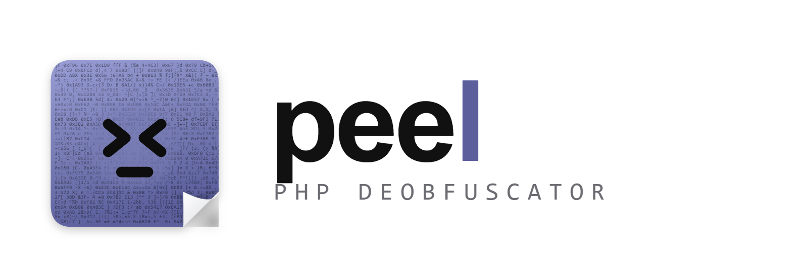
  </picture>
</p>

<p align="center">
  <b>Peel the obfuscation off PHP, right in your browser.</b><br>
  Open source · MIT · free forever · your code never leaves your device
</p>

<p align="center">
  <a href="README.tr.md">Türkçe</a> ·
  <a href="#quick-start">Quick start</a> ·
  <a href="#examples">Examples</a> ·
  <a href="#features">Features</a> ·
  <a href="#command-line">CLI</a> ·
  <a href="#how-it-works">How it works</a> ·
  <a href="#safety-model">Safety model</a>
</p>

<p align="center">
  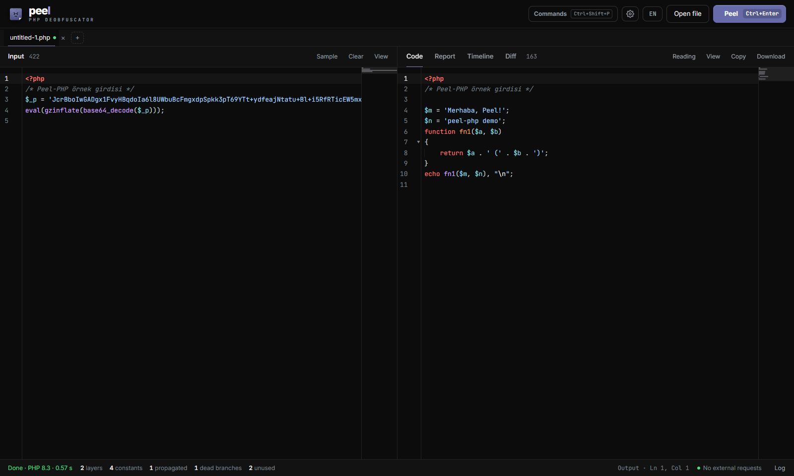
</p>

---

## What is PEEL?

PEEL is a PHP deobfuscator. Paste obfuscated PHP, press **Peel** (`Ctrl + Enter`), and you get readable code back,
plus a report of what the code actually does.

Encoded PHP is usually a stack of `eval(gzinflate(base64_decode(...)))` layers, string tables, `goto` spaghetti and
variable function names. Pattern matching breaks on the first custom twist, and running the file on a real server is dangerous.
PEEL takes a third route:

- **It runs the code in real PHP, safely.** PHP 8.3, 7.4 and 5.2 are compiled to WebAssembly ([php-wasm](https://github.com/WordPress/wordpress-playground))
  and run in a separate worker with a watchdog. Every `eval`, `assert` and `create_function` call is recorded, so each layer
  is captured exactly as PHP decoded it. Network, shell, mail and file writes are recorded, never performed.
- **It proves its own changes.** After every pass the code is parsed again and run again. If the output or the attempted
  side effects change, that pass is rolled back.
- **It keeps what matters.** Code that depends on outside input (`$_GET`, `$_POST`, `$_COOKIE`, request headers) is never
  removed just because the sandbox run did not take that branch, so a webshell's password-protected branch stays in the output.
- **It tells you what the code does.** The report shows the encoder or webshell family it detected, a threat score with evidence,
  the side effects the code tried in the sandbox, and IOCs.
- **It stays on your machine.** There is no server, no telemetry and no upload. The status bar counts every external request the page makes.

## Quick start

You need Node.js 20 or newer.

```bash
git clone https://github.com/LLCForge/Peel-PHP.git
cd Peel-PHP
npm install
npm run dev
```

Open <http://localhost:5173>. Paste code, drop a `.php` file onto the page, or click **Try the sample**, then press **Peel**.
The first run downloads the PHP runtime (WebAssembly) for the version it needs.

To build a static site you can host anywhere:

```bash
npm run build
```

The `dist/` folder is the whole app. In the production build a service worker caches the app, so it also works offline
after the PHP runtimes have been loaded once.

## Screenshots

<table>
  <tr>
    <td width="50%">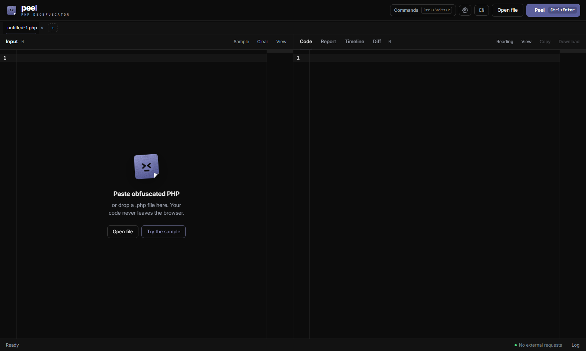<br><sub><b>Start screen.</b> Paste, drop a file or folder, or try the sample.</sub></td>
    <td width="50%">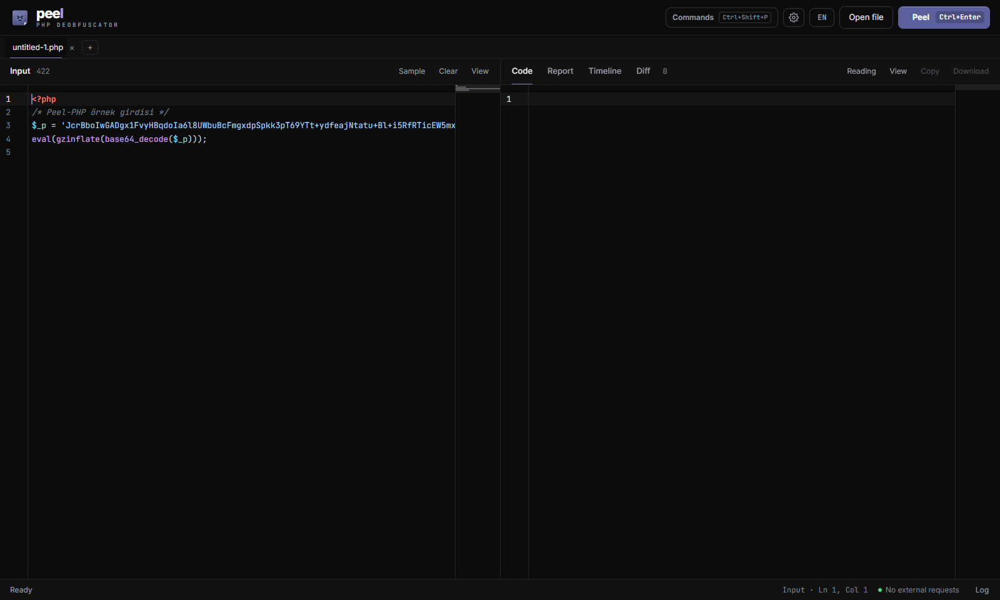<br><sub><b>Input.</b> A CodeMirror editor with PHP highlighting, folding and a minimap.</sub></td>
  </tr>
  <tr>
    <td>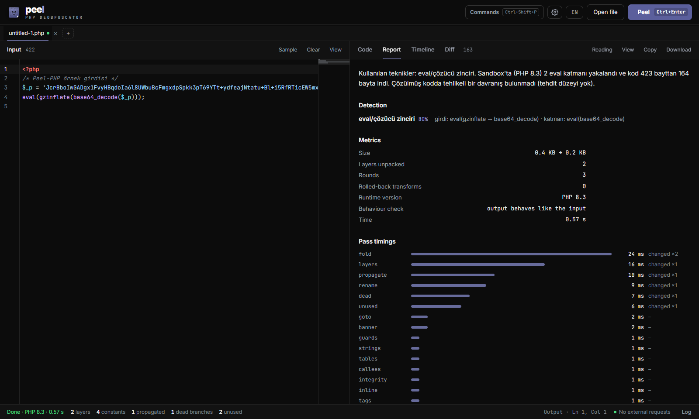<br><sub><b>Report.</b> Summary, detection, threat, sandbox behaviour, IOCs, metrics and pass timings.</sub></td>
    <td>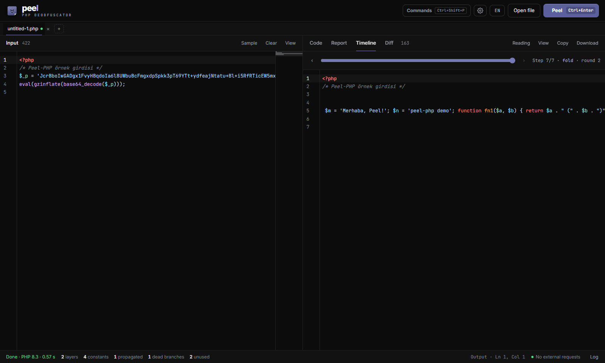<br><sub><b>Timeline.</b> Scrub through the code after every accepted pass.</sub></td>
  </tr>
  <tr>
    <td>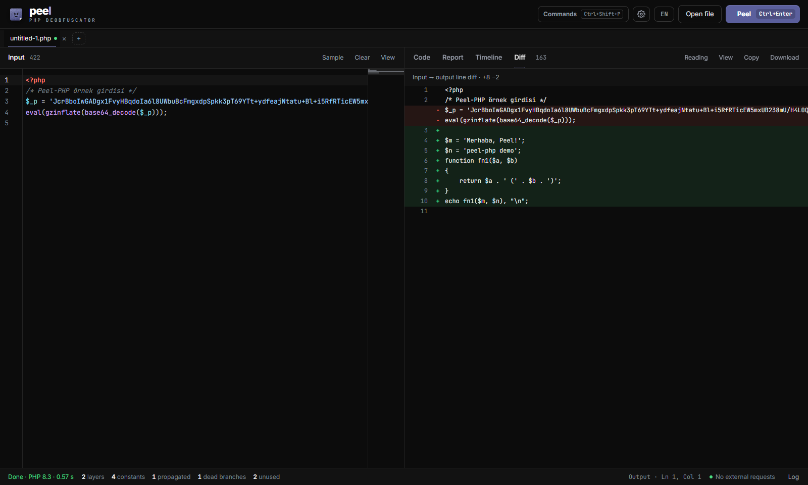<br><sub><b>Diff.</b> What changed between the input and the output.</sub></td>
    <td>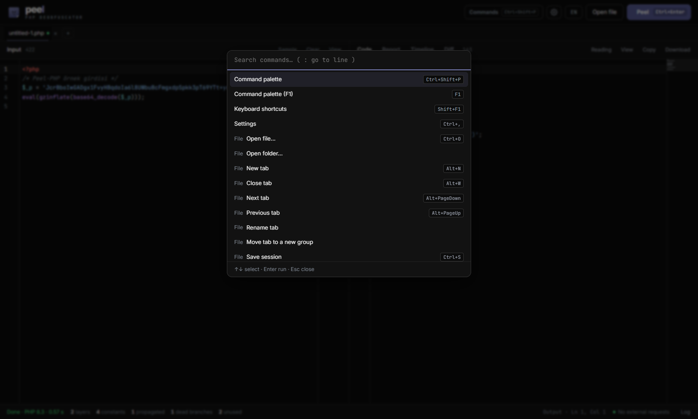<br><sub><b>Command palette.</b> Every action, searchable (<code>Ctrl + Shift + P</code>).</sub></td>
  </tr>
  <tr>
    <td colspan="2">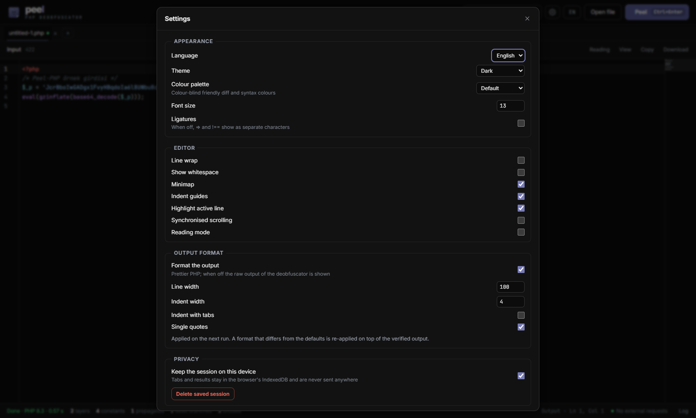<br><sub><b>Settings.</b> Appearance, editor, output format and privacy.</sub></td>
  </tr>
</table>

<p align="center">
  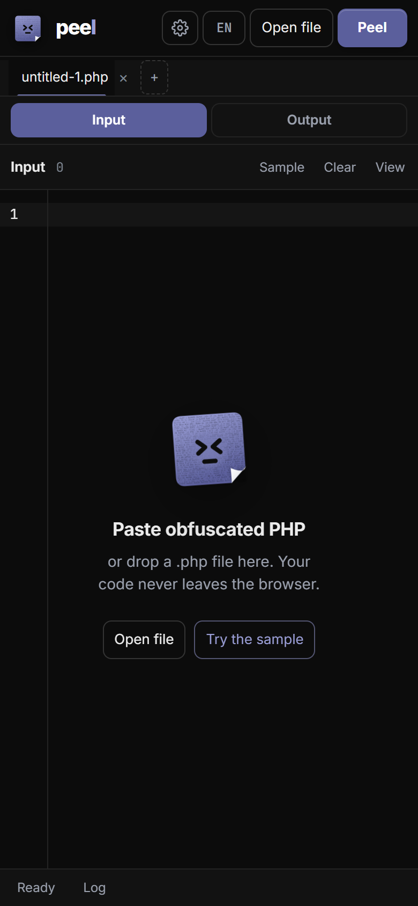<br>
  <sub>The interface also works on a phone.</sub>
</p>

## Examples

All outputs below were produced by the CLI (`peel-php input.php --lang en`) with default settings.
The browser gives the same result, because it uses the same engine.

### The built-in sample

A `gzinflate` + `base64` layer that contains a second `base64` layer, with hex-escaped variable functions, a reversed string
and a dead branch inside:

```php
<?php
/* Peel-PHP örnek girdisi */
$_p = 'JcrBboIwGADgx1FvyHBqdoIa6l8UWbuBcFmgxdpSpkk3pT69YTt+ydfeajNtatu+Bl+i5RfRTicEW5mxUB238mU/H4L0QXm74e7PZghSnY/2QVtJsDfernZSQTGYKg/l…';
eval(gzinflate(base64_decode($_p)));
```

PEEL output (PHP 8.3, 2 eval layers captured, 423 bytes reduced to 164, behaviour verified):

```php
<?php
/* Peel-PHP örnek girdisi */

$m = 'Merhaba, Peel!';
$n = 'peel-php demo';
function fn1($a, $b)
{
    return $a . ' (' . $b . ')';
}
echo fn1($m, $n), "\n";
```

### Small ones

| Input | Output |
|---|---|
| `eval(base64_decode('ZWNobyAnaGknOw=='));` | `echo 'hi';` |
| `$f = "\x73\x74\x72\x72\x65\x76"; echo $f("olleh");` | `echo 'hello';` |
| `$GLOBALS["t"] = array("str_rot13", "uryyb"); echo $GLOBALS["t"][0]($GLOBALS["t"][1]);` | `echo 'hello';` |
| `goto a; b: echo "two\n"; goto c; a: echo "one\n"; goto b; c: echo "end\n";` | `echo "one\n"; echo "two\n"; echo "end\n";` |
| `if (1 > 2) { echo "dead"; } else { echo "live"; }` | `echo 'live';` |

## Features

PEEL has **16 passes**, run in rounds until nothing changes, and a set of report modules.

### Passes

| Pass | What it undoes |
|---|---|
| `layers` | Code captured from `eval`, `assert`, `create_function` and `preg_replace /e` in the sandbox is written back in place. A call site is unpacked only if it produced the same code every time it ran. |
| `guards` | Anti-analysis checks (looking for `evalhook`, `xdebug`, `vld` and similar) become `false`; `__LINE__` is fixed to its value |
| `goto` | YAK Pro style `goto` / label flow is restructured into `if` / `else` and `while`, or linearised where that is not possible |
| `fold` | Pure functions with constant arguments (`base64_decode`, `str_rot13`, `gzinflate`, `chr`, string concatenation…) are computed by real PHP and written as literals. Pure user-defined decoder functions are evaluated with their definitions. |
| `strings` | Escaped strings (`\x`, octal, `\u{}`), `chr(n)` and literal concatenations become readable literals |
| `prege` | `preg_replace('/.*/e', CODE, '')` with literal arguments is replaced by the code itself |
| `propagate` | Constant propagation; `'name'(...)`, `call_user_func('name', ...)` and `call_user_func_array` become direct calls; `$GLOBALS['x']` and `${'x'}` become `$x` |
| `tables` | Constant string and name tables (`$GLOBALS['x'] = [...]`, FOPO-style `$O{4} . $O[9]`) are resolved, only when the table is never written again |
| `callees` | Calls through computed names (`substr($t, 32, 7)()`) become direct calls when the name is pure and the same on every run |
| `dead` | Constant `if` / `?:` / `while` branches and `if (!function_exists('f'))` wrappers |
| `integrity` | Encoder self-checks that read their own file and `die` on tampering; conditions on external input are never touched |
| `inline` | A function that is defined once and called once (`run_code($decrypted)`) is inlined |
| `unused` | Leftover decoder variables, loops, uncalled functions, unused `define()` and unread `__halt_compiler` data (liveness analysis) |
| `rename` | Unreadable identifiers (`O0O0`, `lIl1`, `_0x…`, invisible Unicode, hash-like names) get deterministic names from usage: `arg1`, `item`, `i`, `str`, `fn1`, `Class1`… |
| `banner` | Encoder banners and the marker comments encoders sprinkle into code, once the code no longer reads its own file |
| `tags` | Empty `?><?php` pairs left behind by unpacked layers |

### Detection

| Kind | Families |
|---|---|
| **Encoders and obfuscators** | YAK Pro, FOPO, PHPkoru, PHP Encoder (Free Code Protection Tool), PHPJiaMi, PHPJM, PHP LockIt!, Byterun Protector, generic `eval` / decoder chains |
| **Webshells** | WSO, FilesMan, c99, r57, b374k, IndoXploit, ALFA TEaM, Weevely, P.A.S., China Chopper |
| **Commercial encoders** | ionCube, SourceGuardian, Zend Guard, phpBolt, Swoole Compiler, phpSHIELD, NuCoder: **identified only, not decoded.** The report shows the product, version and required loader that can be read from the file. Decoding them is intentionally out of scope. |

Each detection comes with a confidence value and the evidence that produced it.

### Analysis report

- One-paragraph summary in English or Turkish
- Threat score (0–100) and level, with classes such as code execution from external input, command execution, file manager,
  file upload, mailer, SEO cloaking, remote code download, reverse shell, database dump, backdoor, crypto miner, card skimmer,
  defacement, privilege escalation and persistence, each with evidence
- Sandbox behaviour: network connections, commands, file operations, mail and headers the code tried (none of them happened)
- IOCs: URLs, domains, IPs, email addresses, crypto wallets (base58check-validated), Telegram bot tokens and Discord webhooks;
  known benign and encoder-vendor domains are kept separate
- Metrics: size before and after, layers unpacked, rounds, rolled-back transforms, PHP version, behaviour check, time, pass timings
- JSON export

### Interface

- CodeMirror editors with PHP highlighting, folding, minimap, search, go-to-line, bookmarks and line notes
- Multiple tabs and tab groups, open a whole folder and peel every file in a group
- Sessions saved on the device (IndexedDB) and JSON session import / export
- Code, report, timeline and diff views; reading mode and focus mode
- Command palette and configurable keyboard shortcuts
- Dark, light, high-contrast and colour-blind friendly palettes; output formatting with Prettier PHP
- English and Turkish; mobile layout; keyboard navigation and screen-reader labels

## Command line

The CLI uses the same engine and the same sandbox. In Node the sandbox runs in a `worker_thread` with a watchdog.
Files are read and written as bytes, so invalid UTF-8 and binary data survive unchanged.

```bash
node bin/peel-php.js obfuscated.php -o clean.php --report report.json
cat obfuscated.php | node bin/peel-php.js - > clean.php
node bin/peel-php.js uploads/ --out-dir out --report out/report.json --fail-on high
node bin/peel-php.js shell.php --json --lang en
```

Install it globally with `npm link` and use `peel-php` instead of `node bin/peel-php.js`.

| Option | |
|---|---|
| `-o, --out <file>` | write the decoded code to a file (single input; otherwise stdout) |
| `-d, --out-dir <dir>` | write decoded files to a directory; a directory input keeps its structure |
| `-r, --report <file>` | write the JSON report to a file (an array for a directory input) |
| `--json` | print the JSON report to stdout instead of the code |
| `--lang tr\|en` | report language (default `tr`) |
| `--no-sandbox` | do not execute the code, static transforms only |
| `--version 8.3\|7.4\|5.2` | pin the PHP version (default: automatic) |
| `--fail-on <level>` | exit with code 4 when the threat level reaches `low`, `medium`, `high` or `critical` |
| `-q, --quiet` | no progress or summary output |

A directory is scanned recursively for `.php`, `.php3`–`.php8`, `.phtml` and `.inc` files; symbolic links are not followed.
Inputs are limited to 50 MB.

Exit codes: `0` ok, `1` error, `2` usage error, `4` `--fail-on` threshold reached (takes precedence over errors).

## Library

The package is not on npm. Install it from GitHub and import the entry module:

```bash
npm install github:LLCForge/Peel-PHP
```

```js
import { peel, deobfuscate, analyze, passes } from 'peel-php/src/index.js';

const { code, text, report, verified, version } = await peel(source, { lang: 'en' });
console.log(text);                    // readable code
console.log(verified);                // true if every change was behaviour-checked in the sandbox
console.log(version);                 // PHP version the code ran on, e.g. '8.3'
console.log(report.threat);           // { score, level, classes: [{ id, title, evidence }] }
console.log(report.detection);        // [{ id, name, kind, confidence, evidence }]
console.log(report.iocs.urls);
```

`source` can be a string or a `Uint8Array`. `peel` creates a shared sandbox on first use (a `worker_thread` in Node,
a Web Worker in the browser); pass `{ sandbox: false }` for static transforms only, or your own instance from `createSandbox()`.
`deobfuscate` returns only the code, without the report. If the input cannot be parsed (for example a commercially encoded file),
`peel` still returns a report for it. The report format is documented at the top of [`src/core/analyze.js`](src/core/analyze.js).

## How it works

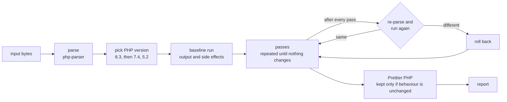

The version is chosen by running the code: PHP 8.3 first, then older versions if 8.3 hits a fatal error or the code relies on
`preg_replace /e`. Every pass is a module in [`src/passes/`](src/passes) that takes the code and a context and returns new code.
The order is in [`src/core/registry.js`](src/core/registry.js).

| Folder | Contents |
|---|---|
| `src/passes/` | the 16 passes |
| `src/core/` | pipeline, parsing, byte strings, scope analysis, pure-function list, layer unpacker, naming, formatting, report assembly |
| `src/sandbox/` | PHP prelude (instrumentation and stubs), engine, watchdog, Web Worker and `worker_thread` hosts |
| `src/report/` | detection, commercial encoder recognition, threat analysis, IOCs, summary |
| `src/ui/` | the web interface |
| `src/cli/`, `bin/` | the command line |
| `test/`, `scripts/` | fixtures, unit tests, benchmark and the scripts that generate them |

## Safety model

- Untrusted code runs only inside php-wasm (WebAssembly) in a separate worker. Each run has a deadline (8 seconds by default);
  `set_time_limit` does not work in php-wasm, so the watchdog terminates a worker that hangs, for example on an infinite loop
  or catastrophic regex backtracking, and the next request starts a fresh one. **Stop** aborts the current run.
- The file system is in memory. `allow_url_fopen` and `allow_url_include` are off, and the browser worker is given no network
  bridge, so PHP sockets cannot connect anywhere. Memory is limited to 256 MB per request.
- On PHP 8 the functions that touch the outside world (shell, sockets, cURL, DNS, mail, headers, file writes and others) are
  replaced by stubs that record the call. On PHP 7.4 and 5.2 shell, socket, cURL and mail functions are disabled and the attempted
  call is recorded from the warning; file writes there only reach the in-memory file system.
  Local file reading stays possible so encoders that read `__FILE__` keep working.
- `eval` itself is not replaced: the decoded code still runs in the caller's scope, so layered encoders that depend on globals
  behave exactly as they would on a server, and PEEL records every layer on the way.
- Transforms that could hide behaviour are restricted: `integrity`, `callees` and `tables` never touch code that depends on external input.
- The report view prints every string with `textContent`; nothing from the decoded code is inserted as HTML.
- Test fixtures and samples are stored XOR + base64 encoded (`.php.x`) and decoded only in memory, so the repository does not
  trip antivirus scanners.

## Honest limits

- The behaviour check compares output, fatal errors and attempted side effects of one run. Code that does nothing visible
  without the right request (a webshell waiting for a password) gets a weaker check.
- Layers are unpacked from what the sandbox observed. A layer behind a branch that did not run in the sandbox stays as it is.
- Only PHP 8.3, 7.4 and 5.2 are bundled. Code that only works on another version may run with warnings or not at all.
- ionCube, SourceGuardian, Zend Guard and the other commercial encoders are only identified, never decoded.
- Without the sandbox (`--no-sandbox`), only static transforms run and nothing is verified.
- The first run in the browser downloads a PHP runtime of roughly 10–18 MB per version.

## Tests

```bash
npm test             # 22 fixtures through the whole pipeline with behaviour checks, then 5 unit test files
node test/run.js goto  # a single fixture, with its log and output
npm run bench        # 39 samples from 10 open-source PHP obfuscators
```

The unit tests cover the report (15 analysis samples), the CLI, translations, the sandbox (layer capture, recorded side effects,
`__FILE__`, the watchdog, PHP 5.2) and value handling.

The benchmark compares the decoded program's output with the original source's, counts the original literals found in the
output, and the eval layers, `goto`s and unreadable names that remain. The samples were made with YAK Pro, naneau,
ALOM, Southern, krypt0nn, lwertugrul, weizenspreu, yapo, GLOBUS and ricardopedias obfuscators by
[`scripts/make-bench.js`](scripts/make-bench.js).

A fixture is a `.php.x` file in [`test/fixtures/`](test/fixtures), generated by [`scripts/make-fixtures.js`](scripts/make-fixtures.js),
with directive comments:

```php
// EXPECT: echo 'hi';      must appear in the output
// GONE: base64_decode     must not appear in the output
// KEEP: $_POST            must stay in the output (code that depends on external input)
```

## Contributing

Issues and pull requests are welcome. If you have a sample PEEL does not handle, please open an issue with a small,
anonymised version of it. A pull request that adds a fixture proving the fix is the fastest way to get it merged.

## License

[MIT](LICENSE). Free to use, change and redistribute, including commercially. There is no paid tier, no account and no telemetry.
