<p align="center">
  <picture>
    <source media="(prefers-color-scheme: dark)" srcset="public/peel-logo-horizontal-dark-1600.png">
    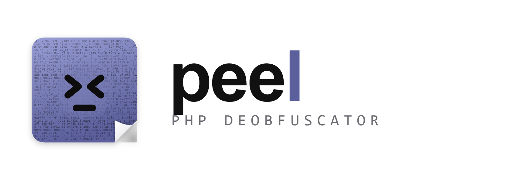
  </picture>
</p>

<p align="center">
  <b>PHP'deki gizlemeyi tarayıcının içinde soyar.</b><br>
  Açık kaynak · MIT · sonsuza dek ücretsiz · kodunuz cihazınızdan çıkmaz
</p>

<p align="center">
  <a href="README.md">English</a> ·
  <a href="#hızlı-başlangıç">Hızlı başlangıç</a> ·
  <a href="#örnekler">Örnekler</a> ·
  <a href="#özellikler">Özellikler</a> ·
  <a href="#komut-satırı">CLI</a> ·
  <a href="#nasıl-çalışır">Nasıl çalışır</a> ·
  <a href="#güvenlik-modeli">Güvenlik modeli</a>
</p>

<p align="center">
  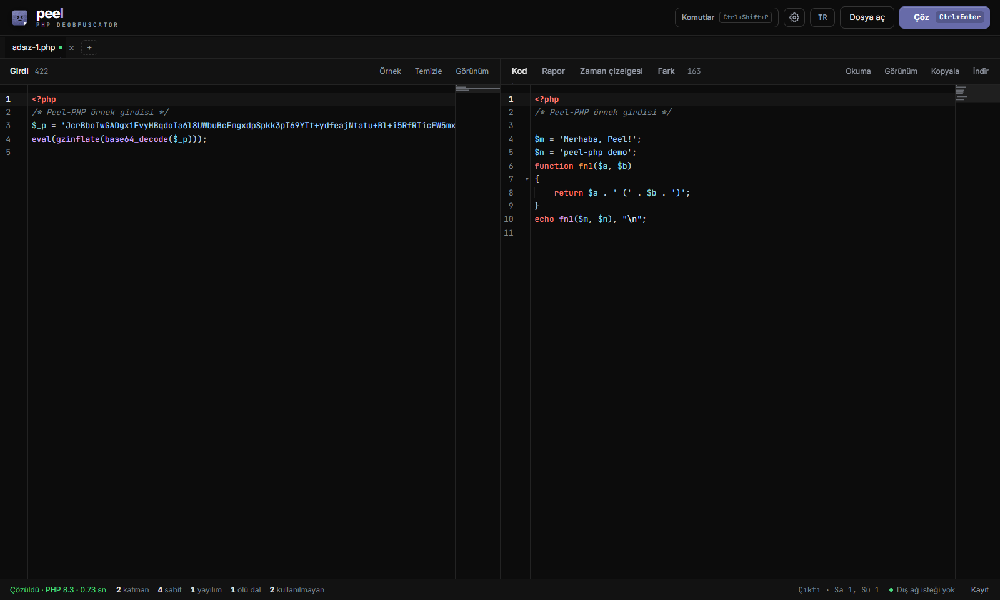
</p>

---

## PEEL nedir?

PEEL bir PHP deobfuscator'ıdır. Gizlenmiş PHP kodunu yapıştırın, **Çöz**'e basın (`Ctrl + Enter`).
Okunur kodu ve kodun gerçekte ne yaptığını anlatan bir raporu geri alırsınız.

Kodlanmış PHP genellikle üst üste binmiş `eval(gzinflate(base64_decode(...)))` katmanları, dizge tabloları, `goto` yumağı ve
değişkenle çağrılan fonksiyon adlarından oluşur. Kalıp eşleme ilk özel dokunuşta kırılır; dosyayı gerçek bir sunucuda çalıştırmak
ise tehlikelidir. PEEL üçüncü bir yol izler:

- **Kodu gerçek PHP'de, güvenle çalıştırır.** PHP 8.3, 7.4 ve 5.2 WebAssembly'ye derlenmiştir ([php-wasm](https://github.com/WordPress/wordpress-playground))
  ve bekçili ayrı bir worker içinde çalışır. Her `eval`, `assert` ve `create_function` çağrısı kaydedilir; böylece her katman
  PHP'nin çözdüğü hâliyle yakalanır. Ağ, kabuk, posta ve dosya yazma çağrıları kaydedilir, gerçekte yapılmaz.
- **Kendi değişikliklerini kanıtlar.** Her pass'ten sonra kod yeniden ayrıştırılır ve yeniden çalıştırılır. Çıktı ya da denenen
  yan etkiler değişirse o pass geri alınır.
- **Önemli olanı korur.** Dış girdiye (`$_GET`, `$_POST`, `$_COOKIE`, istek başlıkları) bağlı kod, sandbox çalıştırması o dala
  girmedi diye silinmez; webshell'in parola korumalı dalı çıktıda kalır.
- **Kodun ne yaptığını söyler.** Raporda tespit edilen encoder ya da webshell ailesi, kanıtlarıyla tehdit puanı, kodun sandbox'ta
  denediği yan etkiler ve IOC'ler bulunur.
- **Makinenizde kalır.** Sunucu, telemetri ya da yükleme yoktur. Durum çubuğu sayfanın yaptığı her dış isteği sayar.

## Hızlı başlangıç

Node.js 20 ya da daha yenisi gerekir.

```bash
git clone https://github.com/LLCForge/Peel-PHP.git
cd Peel-PHP
npm install
npm run dev
```

<http://localhost:5173> adresini açın. Kodu yapıştırın, bir `.php` dosyasını sayfaya sürükleyin ya da **Örnek kodla dene**'ye
tıklayın, sonra **Çöz**'e basın. İlk çalıştırma, gereken sürümün PHP çalışma ortamını (WebAssembly) indirir.

Her yerde barındırabileceğiniz statik bir site için:

```bash
npm run build
```

`dist/` klasörü uygulamanın tamamıdır. Derlenmiş sürümde bir service worker uygulamayı önbelleğe alır; PHP çalışma ortamları
bir kez yüklendikten sonra çevrimdışı da çalışır.

## Ekran görüntüleri

<table>
  <tr>
    <td width="50%">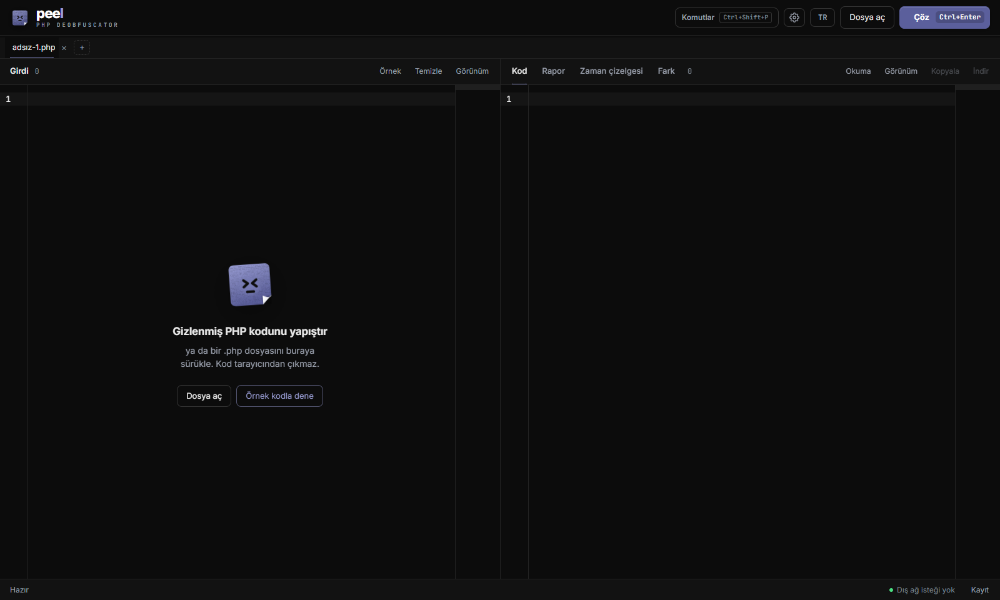<br><sub><b>Başlangıç.</b> Yapıştırın, dosya ya da klasör sürükleyin veya örneği deneyin.</sub></td>
    <td width="50%">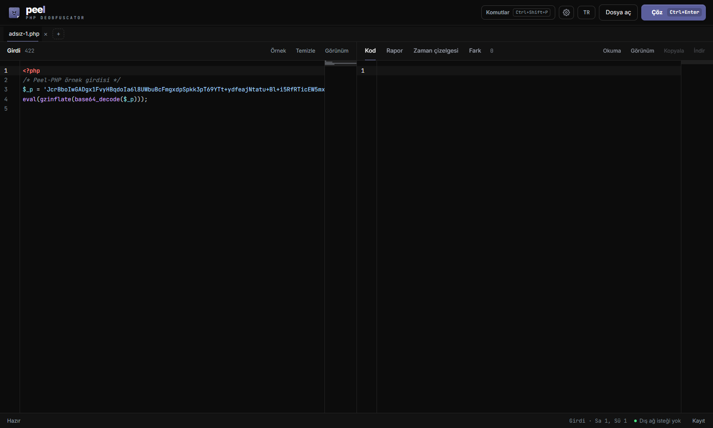<br><sub><b>Girdi.</b> PHP renklendirmesi, katlama ve mini haritalı CodeMirror editörü.</sub></td>
  </tr>
  <tr>
    <td>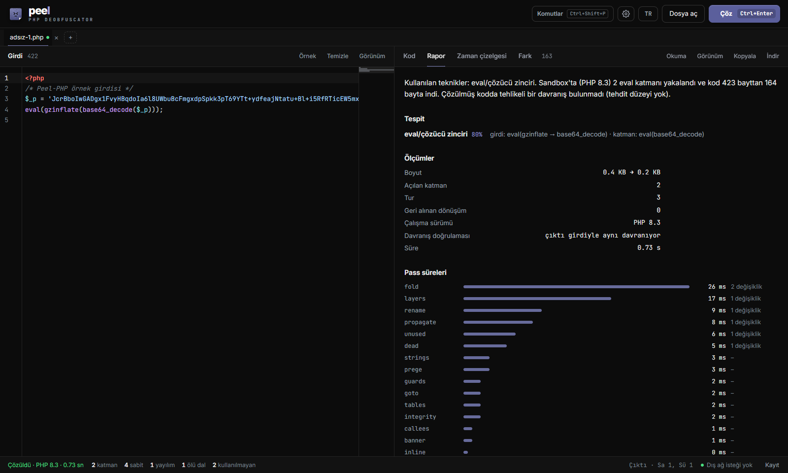<br><sub><b>Rapor.</b> Özet, tespit, tehdit, sandbox davranışı, IOC'ler, ölçümler ve pass süreleri.</sub></td>
    <td>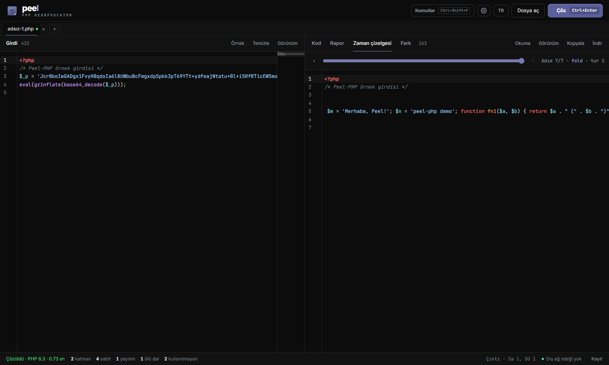<br><sub><b>Zaman çizelgesi.</b> Kabul edilen her pass'ten sonraki kodu kaydırarak izleyin.</sub></td>
  </tr>
  <tr>
    <td>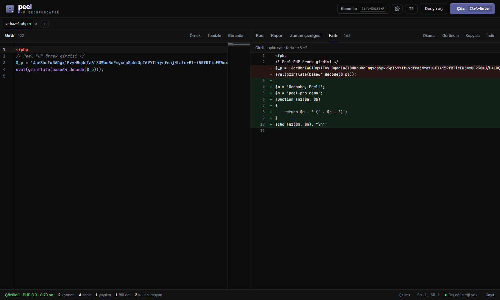<br><sub><b>Fark.</b> Girdi ile çıktı arasında neyin değiştiği.</sub></td>
    <td>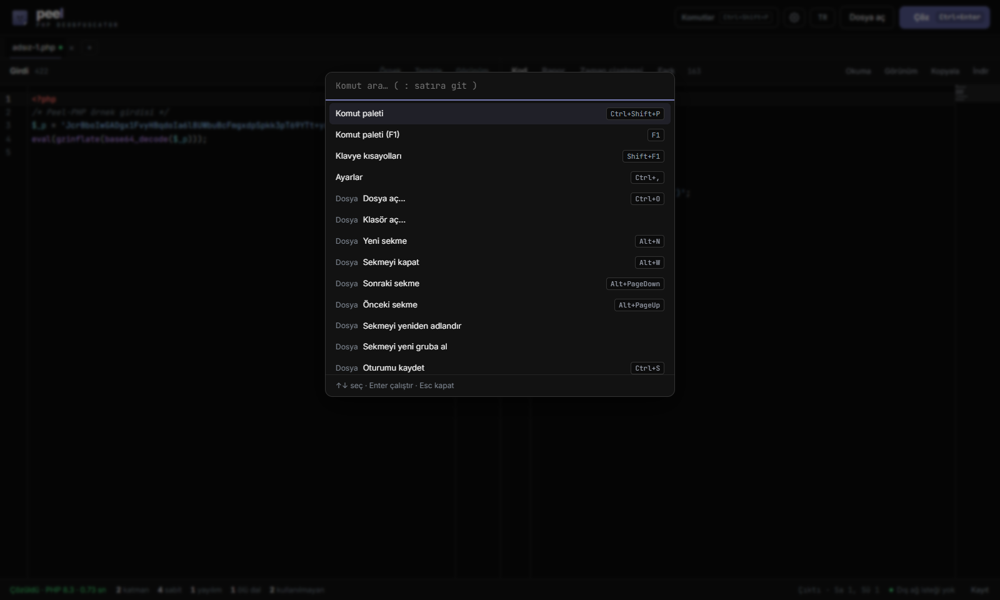<br><sub><b>Komut paleti.</b> Tüm eylemler, aranabilir (<code>Ctrl + Shift + P</code>).</sub></td>
  </tr>
  <tr>
    <td colspan="2">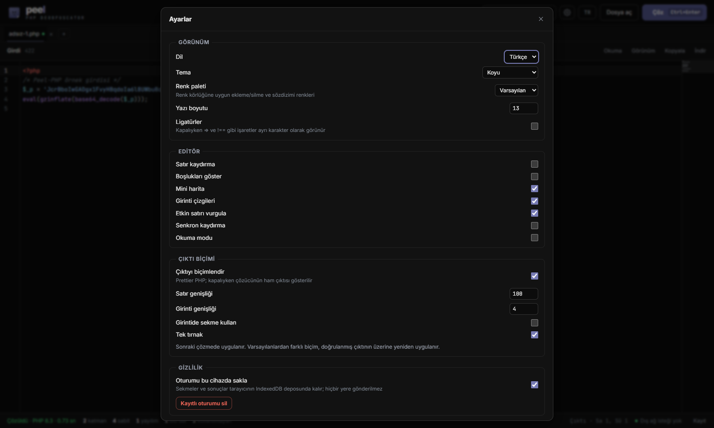<br><sub><b>Ayarlar.</b> Görünüm, editör, çıktı biçimi ve gizlilik.</sub></td>
  </tr>
</table>

<p align="center">
  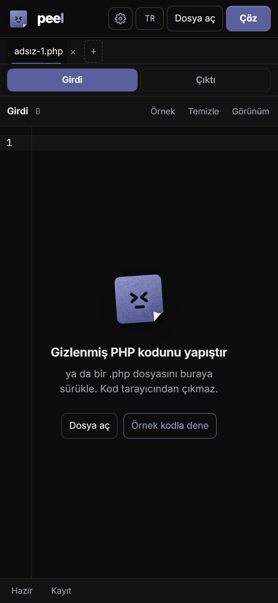<br>
  <sub>Arayüz telefonda da çalışır.</sub>
</p>

## Örnekler

Aşağıdaki çıktıların hepsi varsayılan ayarlarla CLI'dan (`peel-php girdi.php`) alındı.
Tarayıcı aynı motoru kullandığı için aynı sonucu verir.

### Yerleşik örnek

İçinde ikinci bir `base64` katmanı olan bir `gzinflate` + `base64` katmanı; en içte hex kaçışlı değişken fonksiyonlar,
ters çevrilmiş bir dizge ve ölü bir dal:

```php
<?php
/* Peel-PHP örnek girdisi */
$_p = 'JcrBboIwGADgx1FvyHBqdoIa6l8UWbuBcFmgxdpSpkk3pT69YTt+ydfeajNtatu+Bl+i5RfRTicEW5mxUB238mU/H4L0QXm74e7PZghSnY/2QVtJsDfernZSQTGYKg/l…';
eval(gzinflate(base64_decode($_p)));
```

PEEL çıktısı (PHP 8.3, 2 eval katmanı yakalandı, 423 bayttan 164 bayta, davranış doğrulandı):

```php
<?php
/* Peel-PHP örnek girdisi */

$m = 'Merhaba, Peel!';
$n = 'peel-php demo';
function fn1($a, $b)
{
    return $a . ' (' . $b . ')';
}
echo fn1($m, $n), "\n";
```

### Küçük örnekler

| Girdi | Çıktı |
|---|---|
| `eval(base64_decode('ZWNobyAnaGknOw=='));` | `echo 'hi';` |
| `$f = "\x73\x74\x72\x72\x65\x76"; echo $f("olleh");` | `echo 'hello';` |
| `$GLOBALS["t"] = array("str_rot13", "uryyb"); echo $GLOBALS["t"][0]($GLOBALS["t"][1]);` | `echo 'hello';` |
| `goto a; b: echo "two\n"; goto c; a: echo "one\n"; goto b; c: echo "end\n";` | `echo "one\n"; echo "two\n"; echo "end\n";` |
| `if (1 > 2) { echo "dead"; } else { echo "live"; }` | `echo 'live';` |

## Özellikler

PEEL'de değişiklik durana kadar turlar hâlinde çalışan **16 pass** ve bir dizi rapor modülü var.

### Pass'ler

| Pass | Geri aldığı |
|---|---|
| `layers` | Sandbox'ta `eval`, `assert`, `create_function` ve `preg_replace /e` çağrılarından yakalanan kod yerine yazılır. Bir çağrı yeri yalnızca her çalıştığında aynı kodu verdiyse açılır. |
| `guards` | Analiz karşıtı denetimler (`evalhook`, `xdebug`, `vld` vb. arayan koşullar) `false` olur; `__LINE__` değeriyle sabitlenir |
| `goto` | YAK Pro tarzı `goto` / etiket akışı `if` / `else` ve `while` yapısına çevrilir; olmazsa doğrusallaştırılır |
| `fold` | Argümanları sabit saf fonksiyonlar (`base64_decode`, `str_rot13`, `gzinflate`, `chr`, dizge birleştirme…) gerçek PHP'de hesaplanıp literal yazılır. Saf kullanıcı tanımlı açıcı fonksiyonlar tanımlarıyla birlikte hesaplanır. |
| `strings` | Kaçışlı dizgeler (`\x`, sekizli, `\u{}`), `chr(n)` ve literal birleştirmeler okunur literal olur |
| `prege` | Argümanları literal olan `preg_replace('/.*/e', KOD, '')` yerine kodun kendisi yazılır |
| `propagate` | Sabit yayılımı; `'ad'(...)`, `call_user_func('ad', ...)` ve `call_user_func_array` doğrudan çağrı olur; `$GLOBALS['x']` ve `${'x'}` → `$x` |
| `tables` | Sabit dizge ve ad tabloları (`$GLOBALS['x'] = [...]`, FOPO tarzı `$O{4} . $O[9]`) çözülür; yalnızca tabloya bir daha yazılmıyorsa |
| `callees` | Adı hesaplanan çağrılar (`substr($t, 32, 7)()`), ad ifadesi saf ve her çalıştırmada aynıysa doğrudan çağrı olur |
| `dead` | Sabit koşullu `if` / `?:` / `while` dalları ve `if (!function_exists('f'))` sarmalayıcıları |
| `integrity` | Kendi dosyasını okuyup değişiklikte `die` eden encoder denetimleri; dış girdiye bağlı koşullara hiç dokunulmaz |
| `inline` | Bir kez tanımlanıp bir kez çağrılan fonksiyon (`run_code($decrypted)`) yerine konur |
| `unused` | Açıcıdan kalan değişkenler, döngüler, çağrılmayan fonksiyonlar, kullanılmayan `define()` ve okunmayan `__halt_compiler` verisi (canlılık analizi) |
| `rename` | Okunmaz tanımlayıcılar (`O0O0`, `lIl1`, `_0x…`, görünmez Unicode, hash benzeri adlar) kullanımdan çıkarılan belirlenimli adlar alır: `arg1`, `item`, `i`, `str`, `fn1`, `Class1`… |
| `banner` | Kod artık kendi dosyasını okumuyorsa encoder başlıkları ve encoder'ların koda serptiği işaret yorumları |
| `tags` | Açılan katmanların bıraktığı boş `?><?php` çiftleri |

### Tespit

| Tür | Aileler |
|---|---|
| **Encoder ve obfuscator'lar** | YAK Pro, FOPO, PHPkoru, PHP Encoder (Free Code Protection Tool), PHPJiaMi, PHPJM, PHP LockIt!, Byterun Protector, genel `eval` / açıcı zincirleri |
| **Webshell'ler** | WSO, FilesMan, c99, r57, b374k, IndoXploit, ALFA TEaM, Weevely, P.A.S., China Chopper |
| **Ticari encoder'lar** | ionCube, SourceGuardian, Zend Guard, phpBolt, Swoole Compiler, phpSHIELD, NuCoder: **yalnızca tanınır, çözülmez.** Raporda dosyadan okunabilen ürün, sürüm ve gereken loader gösterilir. Bunları çözmek bilinçli olarak kapsam dışıdır. |

Her tespit bir güven değeri ve onu üreten kanıtlarla gelir.

### Analiz raporu

- Türkçe ya da İngilizce tek paragraflık özet
- Tehdit puanı (0–100) ve düzeyi; dış girdiyle kod çalıştırma, komut çalıştırma, dosya yöneticisi, dosya yükleme, toplu posta,
  SEO gizleme, uzaktan kod indirme, ters kabuk, veritabanı dökümü, arka kapı, kripto madenci, kart skimmer'ı, site karartma,
  yetki yükseltme ve kalıcılık gibi sınıflar, her biri kanıtıyla
- Sandbox davranışı: kodun denediği ağ bağlantıları, komutlar, dosya işlemleri, posta ve başlıklar (hiçbiri gerçekleşmedi)
- IOC'ler: URL'ler, alan adları, IP'ler, e-posta adresleri, kripto cüzdanları (base58check ile doğrulanır), Telegram bot token'ları
  ve Discord webhook'ları; bilinen zararsız ve encoder üreticisi alan adları ayrı tutulur
- Ölçümler: önce/sonra boyut, açılan katmanlar, turlar, geri alınan dönüşümler, PHP sürümü, davranış denetimi, süre, pass süreleri
- JSON dışa aktarma

### Arayüz

- PHP renklendirmesi, katlama, mini harita, arama, satıra git, yer imleri ve satır notları olan CodeMirror editörleri
- Birden çok sekme ve sekme grupları; bütün bir klasörü açma ve gruptaki her dosyayı çözme
- Cihazda kaydedilen oturumlar (IndexedDB) ve JSON oturum içe/dışa aktarma
- Kod, rapor, zaman çizelgesi ve fark görünümleri; okuma modu ve odak modu
- Komut paleti ve ayarlanabilir kısayollar
- Koyu, açık, yüksek kontrast ve renk körlüğüne uygun paletler; Prettier PHP ile çıktı biçimlendirme
- Türkçe ve İngilizce; mobil yerleşim; klavye ile gezinme ve ekran okuyucu etiketleri

## Komut satırı

CLI aynı motoru ve aynı sandbox'ı kullanır. Node'da sandbox bekçili bir `worker_thread` içinde çalışır.
Dosyalar bayt olarak okunup yazılır; geçersiz UTF-8 ve ikili veri bozulmaz.

```bash
node bin/peel-php.js gizli.php -o temiz.php --report rapor.json
cat gizli.php | node bin/peel-php.js - > temiz.php
node bin/peel-php.js uploads/ --out-dir cikti --report cikti/rapor.json --fail-on high
node bin/peel-php.js shell.php --json
```

`npm link` ile global kurup `node bin/peel-php.js` yerine `peel-php` yazabilirsiniz.

| Seçenek | |
|---|---|
| `-o, --out <dosya>` | çözülmüş kodu dosyaya yaz (tek girdi; yoksa stdout) |
| `-d, --out-dir <dizin>` | çözülmüş dosyaları dizine yaz; dizin girdisinde yapı korunur |
| `-r, --report <dosya>` | JSON raporu dosyaya yaz (dizin girdisinde dizi) |
| `--json` | kod yerine JSON raporu stdout'a yaz |
| `--lang tr\|en` | rapor dili (varsayılan `tr`) |
| `--no-sandbox` | kodu çalıştırma, yalnızca statik dönüşümler |
| `--version 8.3\|7.4\|5.2` | PHP sürümünü sabitle (varsayılan: otomatik) |
| `--fail-on <düzey>` | tehdit düzeyi `low`, `medium`, `high` ya da `critical` eşiğine ulaşırsa 4 koduyla çık |
| `-q, --quiet` | ilerleme ve özet yazma |

Dizin girdisinde `.php`, `.php3`–`.php8`, `.phtml` ve `.inc` dosyaları özyinelemeli taranır; sembolik bağlar izlenmez.
Girdi sınırı 50 MB'tır.

Çıkış kodları: `0` tamam, `1` hata, `2` kullanım hatası, `4` `--fail-on` eşiğine ulaşıldı (hatadan önceliklidir).

## Kütüphane

Paket npm'de değil. GitHub'dan kurup giriş modülünü içe aktarın:

```bash
npm install github:LLCForge/Peel-PHP
```

```js
import { peel, deobfuscate, analyze, passes } from 'peel-php/src/index.js';

const { code, text, report, verified, version } = await peel(kaynak, { lang: 'tr' });
console.log(text);                    // okunur kod
console.log(verified);                // her değişiklik sandbox'ta davranış denetiminden geçtiyse true
console.log(version);                 // kodun çalıştığı PHP sürümü, ör. '8.3'
console.log(report.threat);           // { score, level, classes: [{ id, title, evidence }] }
console.log(report.detection);        // [{ id, name, kind, confidence, evidence }]
console.log(report.iocs.urls);
```

`kaynak` bir dizge ya da `Uint8Array` olabilir. `peel` ilk kullanımda ortak bir sandbox oluşturur (Node'da `worker_thread`,
tarayıcıda Web Worker); yalnızca statik dönüşümler için `{ sandbox: false }` ya da `createSandbox()` ile kendi örneğinizi verin.
`deobfuscate` raporsuz yalnızca kodu döndürür. Girdi ayrıştırılamasa da (ör. ticari şifreli bir dosya) `peel` onun için rapor üretir.
Rapor biçimi [`src/core/analyze.js`](src/core/analyze.js) dosyasının başında anlatılıyor.

## Nasıl çalışır

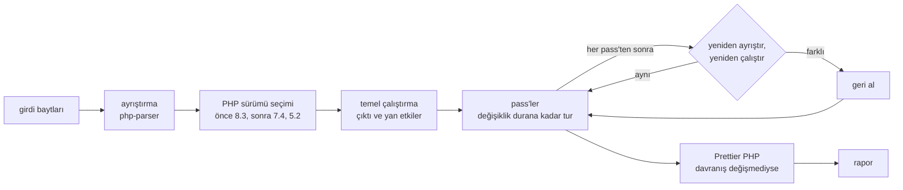

Sürüm, kod çalıştırılarak seçilir: önce PHP 8.3; 8.3'te fatal hata olursa ya da kod `preg_replace /e`'ye dayanıyorsa eski sürümler
denenir. Her pass, [`src/passes/`](src/passes) içinde kodu ve bir bağlamı alıp yeni kodu döndüren bir modüldür.
Sıra [`src/core/registry.js`](src/core/registry.js) içindedir.

| Klasör | İçerik |
|---|---|
| `src/passes/` | 16 pass |
| `src/core/` | çözme hattı, ayrıştırma, bayt dizgeleri, kapsam analizi, saf fonksiyon listesi, katman açıcı, adlandırma, biçimlendirme, rapor |
| `src/sandbox/` | PHP prelude'u (araçlama ve taklitler), motor, bekçi, Web Worker ve `worker_thread` host'ları |
| `src/report/` | tespit, ticari encoder tanıma, tehdit analizi, IOC'ler, özet |
| `src/ui/` | web arayüzü |
| `src/cli/`, `bin/` | komut satırı |
| `test/`, `scripts/` | fixture'lar, birim testleri, benchmark ve bunları üreten betikler |

## Güvenlik modeli

- Güvenilmeyen kod yalnızca ayrı bir worker içindeki php-wasm'da (WebAssembly) çalışır. Her çalıştırmanın bir son tarihi vardır
  (varsayılan 8 saniye). php-wasm'da `set_time_limit` işlemediği için kilitlenen worker'ı (sonsuz döngü, felaket düzeyde regex geri
  izlemesi) bekçi sonlandırır; sıradaki istek yeni bir worker'da başlar. **Durdur** o anki çalıştırmayı keser.
- Dosya sistemi bellektedir. `allow_url_fopen` ve `allow_url_include` kapalıdır; tarayıcıdaki worker'a ağ köprüsü verilmez,
  yani PHP soketleri hiçbir yere bağlanamaz. İstek başına bellek 256 MB ile sınırlıdır.
- PHP 8'de dış dünyaya dokunan fonksiyonlar (kabuk, soketler, cURL, DNS, posta, başlıklar, dosya yazma ve diğerleri) çağrıyı
  kaydeden taklitlerle değiştirilir. PHP 7.4 ve 5.2'de kabuk, soket, cURL ve posta fonksiyonları kapatılır ve denenen çağrı uyarıdan
  kaydedilir; orada dosya yazma yalnızca bellekteki dosya sistemine ulaşır. `__FILE__` okuyan encoder'lar çalışsın diye yerel dosya okuma açık kalır.
- `eval`'in kendisi değiştirilmez: çözülen kod çağıranın kapsamında çalışır; global değişkenlere güvenen katmanlı encoder'lar
  sunucudaki gibi davranır, PEEL de yol boyunca her katmanı kaydeder.
- Davranışı gizleyebilecek dönüşümler sınırlıdır: `integrity`, `callees` ve `tables` dış girdiye bağlı koda hiç dokunmaz.
- Rapor görünümü her dizgeyi `textContent` ile basar; çözülen koddan gelen hiçbir şey HTML olarak eklenmez.
- Test fixture'ları ve örnekler XOR + base64 kodlu (`.php.x`) saklanır ve yalnızca bellekte çözülür; depo antivirüs
  tarayıcılarını tetiklemez.

## Dürüst sınırlar

- Davranış denetimi tek bir çalıştırmanın çıktısını, fatal hatalarını ve denenen yan etkilerini karşılaştırır. Doğru istek
  gelmeden görünür bir şey yapmayan kod (parola bekleyen bir webshell) daha zayıf bir denetimden geçer.
- Katmanlar sandbox'ın gözlediklerinden açılır. Sandbox'ta çalışmayan bir dalın arkasındaki katman olduğu gibi kalır.
- Yalnızca PHP 8.3, 7.4 ve 5.2 pakettedir. Yalnızca başka bir sürümde çalışan kod uyarılarla çalışabilir ya da hiç çalışmayabilir.
- ionCube, SourceGuardian, Zend Guard ve diğer ticari encoder'lar yalnızca tanınır, çözülmez.
- Sandbox olmadan (`--no-sandbox`) yalnızca statik dönüşümler çalışır ve hiçbir şey doğrulanmaz.
- Tarayıcıdaki ilk çalıştırma, sürüm başına yaklaşık 10–18 MB'lık bir PHP çalışma ortamı indirir.

## Testler

```bash
npm test             # 22 fixture tüm hattan davranış denetimiyle geçer, ardından 5 birim test dosyası
node test/run.js goto  # tek bir fixture, log ve çıktısıyla
npm run bench        # 10 açık kaynak PHP obfuscator'ından 39 örnek
```

Birim testleri raporu (15 analiz örneği), CLI'ı, çevirileri, sandbox'ı (katman yakalama, kaydedilen yan etkiler, `__FILE__`,
bekçi, PHP 5.2) ve değer işlemeyi kapsar.

Benchmark, çözülmüş programın çıktısını özgün kaynağınkiyle karşılaştırır; çıktıda bulunan özgün literalleri, kalan eval
katmanlarını, `goto`'ları ve okunmaz adları sayar. Örnekler YAK Pro, naneau, ALOM, Southern, krypt0nn, lwertugrul, weizenspreu,
yapo, GLOBUS ve ricardopedias obfuscator'larıyla [`scripts/make-bench.js`](scripts/make-bench.js) tarafından üretildi.

Fixture, [`test/fixtures/`](test/fixtures) içinde [`scripts/make-fixtures.js`](scripts/make-fixtures.js) ile üretilen,
yönerge yorumları olan bir `.php.x` dosyasıdır:

```php
// EXPECT: echo 'hi';      çıktıda bulunmalı
// GONE: base64_decode     çıktıda bulunmamalı
// KEEP: $_POST            çıktıda kalmalı (dış girdiye bağlı kod)
```

## Katkı

Issue ve pull request'ler memnuniyetle karşılanır. PEEL'in çözemediği bir örneğiniz varsa küçük ve anonimleştirilmiş bir
sürümüyle issue açın. Düzeltmeyi kanıtlayan bir fixture ekleyen pull request en hızlı birleşen pull request'tir.

## Lisans

[MIT](LICENSE). Ticari kullanım dahil özgürce kullanabilir, değiştirebilir ve dağıtabilirsiniz. Ücretli sürüm, hesap ya da telemetri yoktur.
